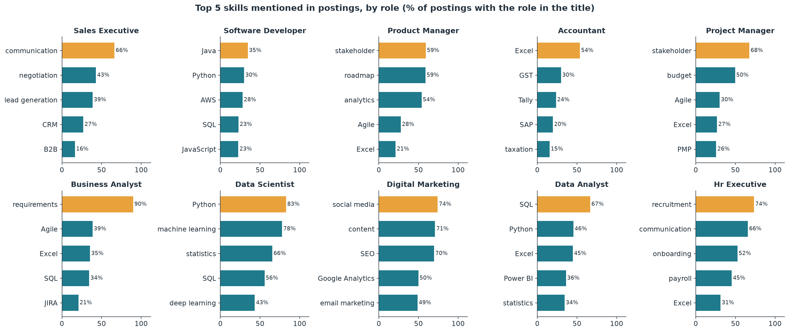
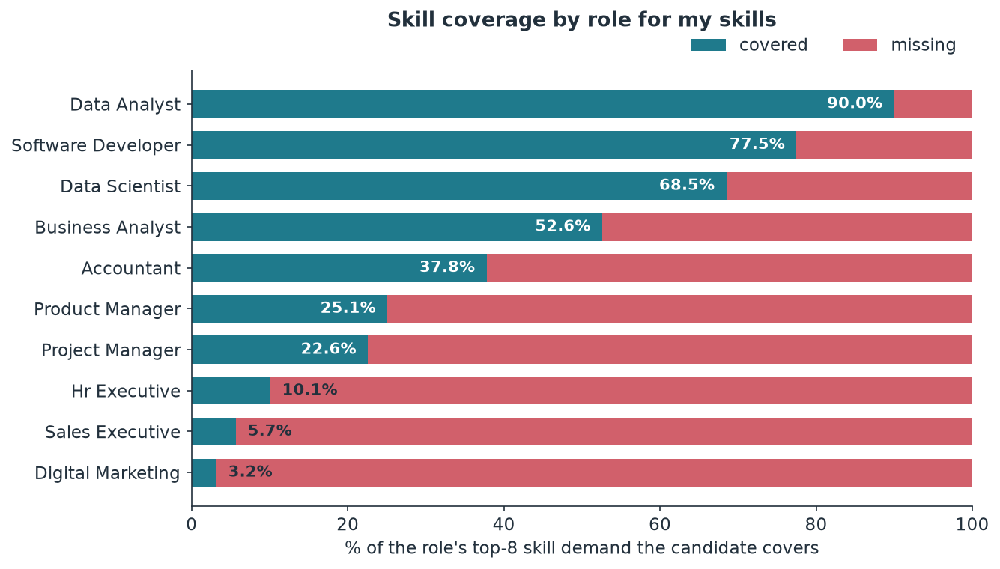
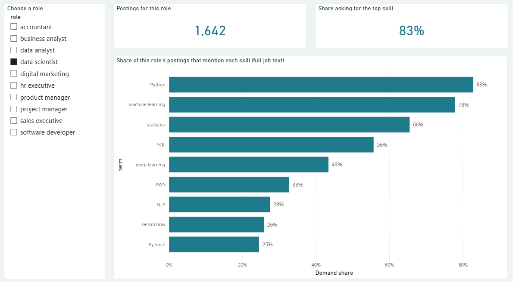
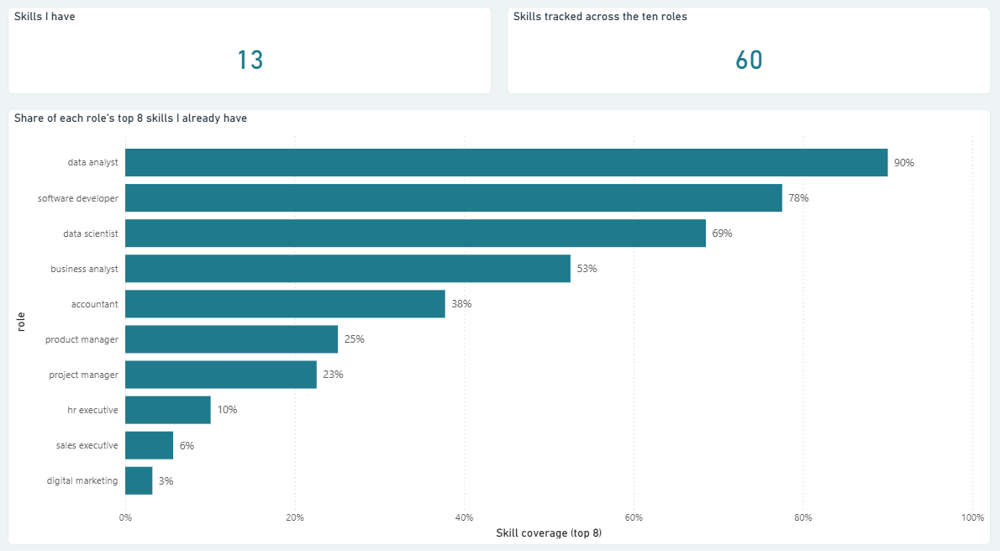

# TalentScope: Job Market and Skill Gap Analysis (India)

## What I wanted to find out

What skills do companies look for in a role, and what skills does a candidate have? Once I had both, I could see what the candidate is missing for the role they want. I collected postings for ten roles in India from the Adzuna API (24 November 2026), counted the skills in the full job text, and built a skill-gap check on top. It uses Python and SQL, with a Power BI dashboard.

It's aimed at people like me who are trying to decide what to learn for the role they want.

## What I found

| Role | India postings | Top skills mentioned |
|---|---|---|
| Sales executive | 3,582 | communication 66%, negotiation 43%, lead generation 39% |
| Software developer | 3,072 | Java 35%, Python 30%, AWS 28% |
| Product manager | 2,570 | stakeholder 59%, roadmap 59%, analytics 54% |
| Accountant | 2,498 | Excel 54%, GST 30%, Tally 24% |
| Project manager | 2,215 | stakeholder 68%, budget 50%, Agile 30% |
| Business analyst | 1,660 | requirements 90%, Agile 39%, Excel 35% |
| Data scientist | 1,642 | Python 83%, machine learning 78%, statistics 66% |
| Digital marketing | 1,026 | social media 74%, content 71%, SEO 70% |
| Data analyst | 938 | SQL 67%, Python 46%, Excel 45% |
| HR executive | 680 | recruitment 74%, communication 66%, onboarding 52% |

Postings are those with the role in the job title. The percentages are the share of those postings whose full text mentions the skill. The API only gives 500 characters per ad, so I asked Adzuna to count matches on the full text instead.

Each role asks for quite different things, so I always compare against one target role. Excel is the most shared skill. It's on the list for 8 of the 10 roles and is highest for accountants (54%). SQL also shows up outside analyst roles: it's in 56% of data scientist postings, 34% of business analyst and 23% of software developer postings. Only 7 of the skills I tracked appear across three or more roles: Excel, SQL, Python, Power BI, Agile, JIRA and AWS.

"Remote" is mentioned in 4% to 13% of postings (data analyst is highest at 13%, the other nine are under 10%). "Hybrid" is in 1% to 15%. These are keyword mentions, not a count of fully remote jobs.



## Skill gap check

These are my own skills: SQL, Excel, Power BI, Python, statistics, ETL, machine learning, Java, Spring Boot, Git, React, JavaScript and Agile. Coverage is the share of a role's top eight skills (weighted by how often each is mentioned) that I already have.

| Role | Coverage | Biggest gaps |
|---|---|---|
| Data analyst | 90% | Tableau |
| Software developer | 78% | AWS, Docker |
| Data scientist | 69% | deep learning, AWS, NLP |
| Business analyst | 53% | requirements, JIRA, Tableau |
| Accountant | 38% | GST, Tally, SAP |
| Product manager | 25% | stakeholder, roadmap, analytics |



Try it with your own skills:

```bash
python analysis/skill_gap.py --role "data scientist" --skills "SQL,Python,Excel"
```

## Power BI dashboard

Five pages: roles overview, skills by role, skill gap across roles, skill gap for one role, and data analyst postings. The skill-gap measure is in DAX and matches the Python script and the SQL query. Files are in [`powerbi/`](powerbi/).







## How I built it

I used the API to get the counts for each role and skill (`fetch_role_demand.py`) and to download the data analyst postings (`fetch_adzuna.py`). Then `build_dataset.py` cleans the postings: it removes repeated adverts, keeps analyst titles from June 2026 on, and works out seniority, remote mentions, experience and salary. Everything is saved as CSV in `data/`, and the notebooks, SQL and Power BI all read from there. `analysis/skill_gap.py` runs the gap check from the command line, and `tests/` has a few checks for it.

## Data analyst postings

Adzuna only returns the first 500 characters of each posting. For data analyst I also looked at a cleaned sample of 212 recent postings (June to November 2026).

- 62% are plain "data analyst" roles and 29% are BI analyst or developer roles.
- Bangalore leads (52 postings), then Hyderabad (18) and Pune (11).
- 11 postings mention remote or work from home.
- The middle salary is about 7.25 lakh a year, but only 28 postings state one.
- The middle experience asked is 4 years, where it's stated (28 postings).

More in [`notebooks/data_analyst_deep_dive.ipynb`](notebooks/data_analyst_deep_dive.ipynb).

## Limits

- It's one job site on one day, so LinkedIn or Naukri may look different.
- A skill being mentioned doesn't mean it's required.
- I only count postings with the role in the title, so "HR generalist" isn't counted under "hr executive".
- The skill lists are my own choice, and salary figures include Adzuna's estimates.
- The gap score ignores experience, degrees and soft skills.
- It only covers India.

## What's in the repo

- [`notebooks/job_market_by_role.ipynb`](notebooks/job_market_by_role.ipynb): the main analysis
- [`notebooks/data_analyst_deep_dive.ipynb`](notebooks/data_analyst_deep_dive.ipynb): the 212 recent data analyst postings
- [`sql/job_market_queries.sql`](sql/job_market_queries.sql): 19 SQL queries (joins, window functions, CTEs, a skill-gap query) with the results I got
- [`analysis/skill_gap.py`](analysis/skill_gap.py): the command-line gap tool
- [`powerbi/`](powerbi/): the Power BI project
- [`data/`](data/): the cleaned datasets and my own skills list, with a short [column guide](data/README.md)
- [`data_collection/`](data_collection/): the scripts that collect and clean the data
- [`docs/web-app.md`](docs/web-app.md): an earlier web app version (FastAPI, React, MongoDB)

I don't publish the job descriptions themselves, only the counts and the columns I worked out from them. So the raw downloads aren't in the repo, and `build_dataset.py` needs a fresh download with your own key. The CSVs in `data/` are enough to rerun the notebooks, SQL and dashboard.

To refresh the data:

```bash
pip install -r requirements.txt
# get a free key at https://developer.adzuna.com, then:
export ADZUNA_APP_ID=...  ADZUNA_APP_KEY=...
python data_collection/fetch_role_demand.py
```

Job data from [Adzuna](https://www.adzuna.in).

Author: Nida Farheen Khan · [LinkedIn](https://www.linkedin.com/in/nida-khan-237715279)
