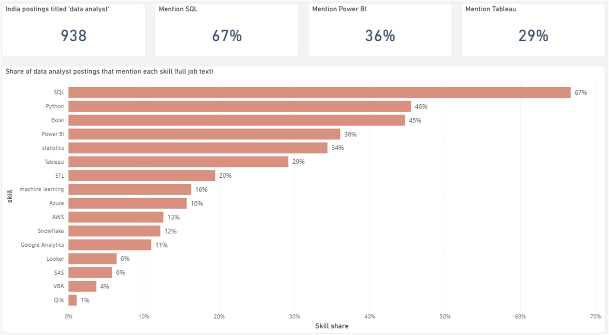
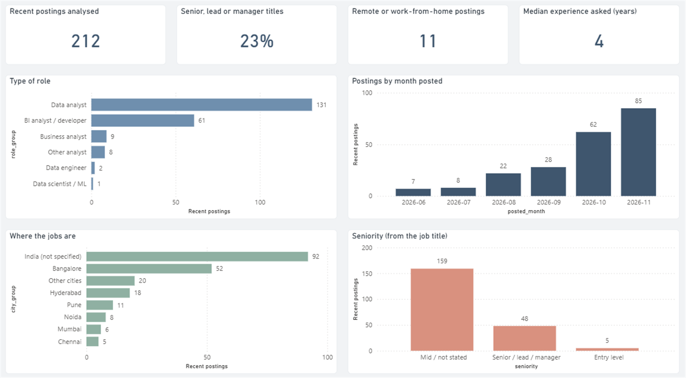
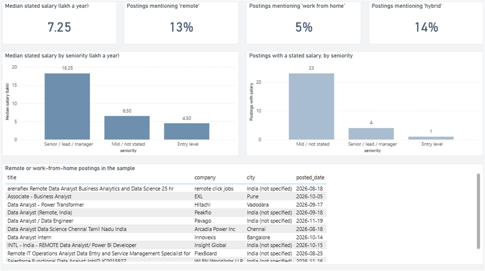
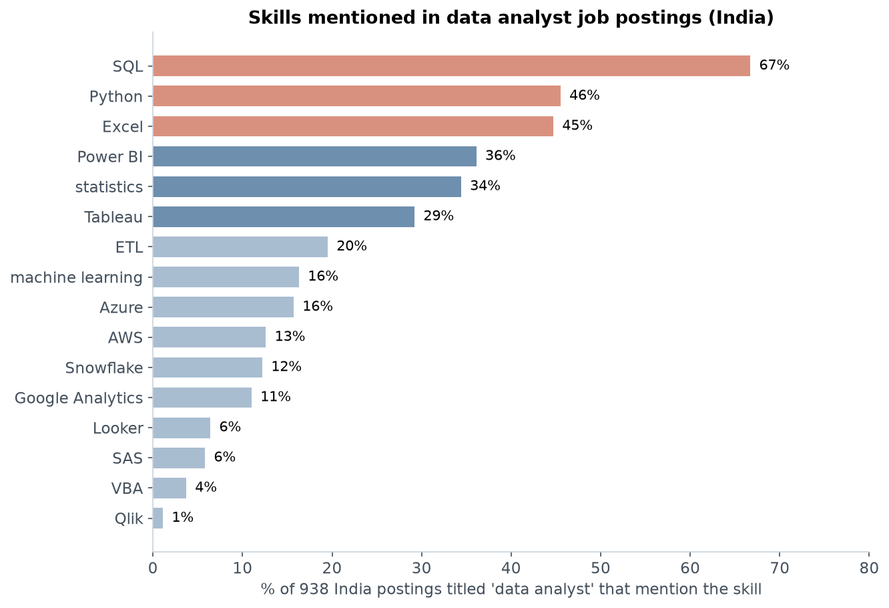
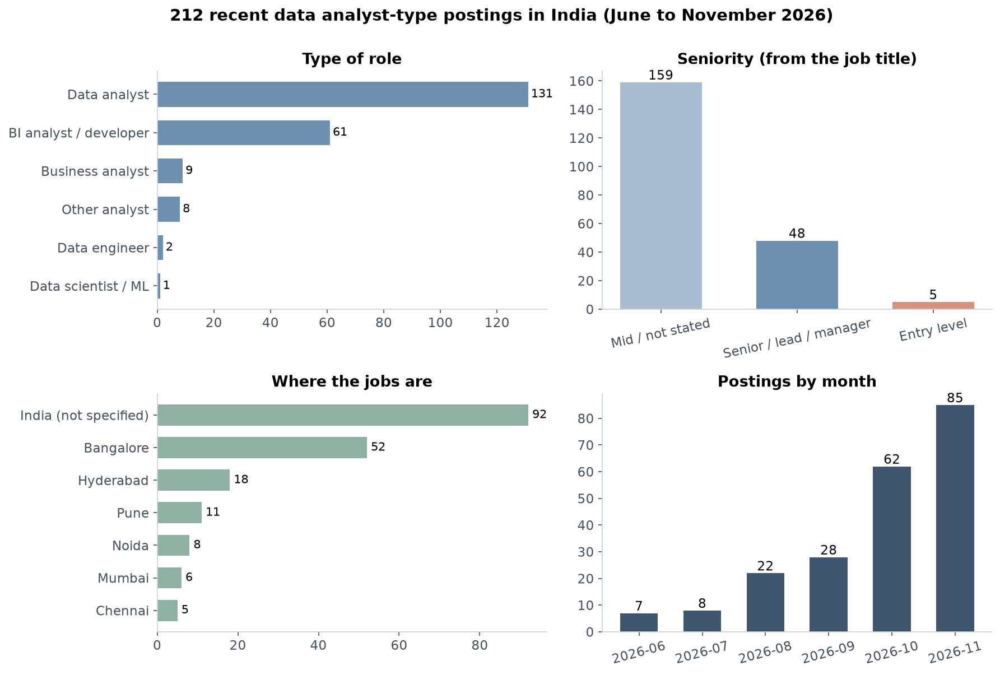

# Data Analyst Job Market in India

**What do employers in India ask for in data analyst jobs, and what do those jobs look like?**

I wanted to know which skills to learn first, so I collected job postings from the Adzuna job search API (24 November 2026), cleaned them, analysed them with Python and SQL, and built a Power BI dashboard.

## What I found

| Question | Answer |
|---|---|
| Which skill matters most? | **SQL.** 67% of India postings titled "data analyst" mention it |
| What comes next? | **Python (46%) and Excel (45%)**, then Power BI (36%), statistics (34%) and Tableau (29%) |
| Power BI or Tableau? | Power BI is mentioned about **1.2 times as often** as Tableau (339 vs 274 postings) |
| What about statistics? | It appears in 34% of postings, more than twice as often as machine learning (16%) |
| What about cloud and pipeline skills? | Azure (16%), AWS (13%), Snowflake (12%) and ETL (20%) are a clear second tier after the core tools |
| What kinds of roles are there? | In 212 recent postings, 62% are "data analyst" and 29% are BI analyst or developer roles |
| Where are the jobs? | **Bangalore** leads (52 postings), then Hyderabad (18) and Pune (11) |
| How much remote work is there? | About **13% of postings mention "remote"**, 5% "work from home" and 14% "hybrid" (these overlap, so do not add them up) |
| What do the jobs pay? | A middle value of about **7.25 lakh a year** from the 28 postings that state a salary |
| How much experience do they ask for? | A middle value of **4 years**, where it is stated (28 postings) |

## Power BI dashboard







The dashboard has three pages: which skills employers ask for, what the recent postings look like, and what I found about remote work and pay. Files are in [`powerbi/`](powerbi/).

## How I did it

**Collecting the data.** Adzuna's API only returns the first 500 characters of each job description. That is not enough to count skills reliably, because the skills list often comes later in an advert. So I used the data in two ways:

1. **For skill demand,** I asked Adzuna how many India postings with "data analyst" in the title mention each skill anywhere in the full text. There were **938** such postings.
2. **For everything else,** I downloaded 424 postings and cleaned them down to 212 recent ones, to look at roles, seniority, cities, remote work and pay.

**Cleaning.** I removed repeated adverts, kept analyst-type job titles, kept only postings from June 2026 on (older ones are stale), and removed reposts. Salary needed extra care: only 34 postings show one, and some ranges were not believable (for example 50,000 to 7,00,000 rupees a year). I kept 28 with a sensible range.

| Step | Postings left |
|---|---|
| Downloaded | 424 |
| Repeated ids removed | 406 |
| Analyst-type titles | 370 |
| Posted from June 2026 | 222 |
| Reposts removed | 212 |

**A check on my own numbers.** The 212-posting sample can only see 500 characters, so I used it to double-check the main result. Among postings that name a tool, SQL comes first and Tableau comes last in both views, so the ranking holds up.





## What this means if you are starting out

1. **Learn SQL first.** It is in two thirds of postings.
2. **Get solid at Excel and learn basic Python** (pandas). Each is in about 45% of postings.
3. **Power BI is a sensible first dashboard tool,** because it is asked for more often than Tableau.
4. **Do not leave out statistics.** More than a third of postings mention it.
5. **Add a cloud or ETL skill later.** They show up in roughly 1 in 8 to 1 in 5 postings.
6. **For remote work, expect a small share of the market,** and check every employer before applying. A few of the remote adverts I found looked generic or too good to be true.

## Limits of this analysis

- It is **one job site on one day**. LinkedIn, Naukri and others may look different, and I could not use them.
- A skill being **mentioned** does not mean it is **required**.
- The 938 count includes any advert currently listed on Adzuna, so a few old or repeated adverts may be in it.
- The detailed sample is small (212 postings), and salary and experience rest on only 28 postings each. I would not quote the salary as "the market rate".
- The rise in postings towards November does not mean hiring is growing. Older adverts expire, so recent months always look fuller.
- **Adzuna does not cover Saudi Arabia or the UAE** (I tested both and the API has no data for them), so this study covers India only.

## What is in this repository

| Path | What it is |
|---|---|
| [`notebooks/job_market_analysis.ipynb`](notebooks/job_market_analysis.ipynb) | The full analysis with charts and explanations |
| [`sql/job_market_queries.sql`](sql/job_market_queries.sql) | 12 SQL queries (joins, window functions, CTEs) with the results I got |
| [`powerbi/`](powerbi/) | The Power BI project and notes on how to open it |
| [`data/`](data/) | The cleaned datasets: 212 postings, their skills, and the skill demand counts |
| [`data_collection/`](data_collection/) | Scripts that download and clean the data from Adzuna |
| [`docs/web-app.md`](docs/web-app.md) | An earlier interactive web app version of this project (FastAPI, React, MongoDB) |

I do not publish the job descriptions themselves, only the columns I worked out from them.

**To refresh the data**

```bash
pip install -r requirements.txt
# get a free key at https://developer.adzuna.com, then:
export ADZUNA_APP_ID=...  ADZUNA_APP_KEY=...
python data_collection/fetch_adzuna.py
python data_collection/fetch_skill_counts.py
python data_collection/build_dataset.py
```

Job data from [Adzuna](https://www.adzuna.in).

**Author:** Nida Farheen Khan · [LinkedIn](https://www.linkedin.com/in/nida-khan-237715279)
