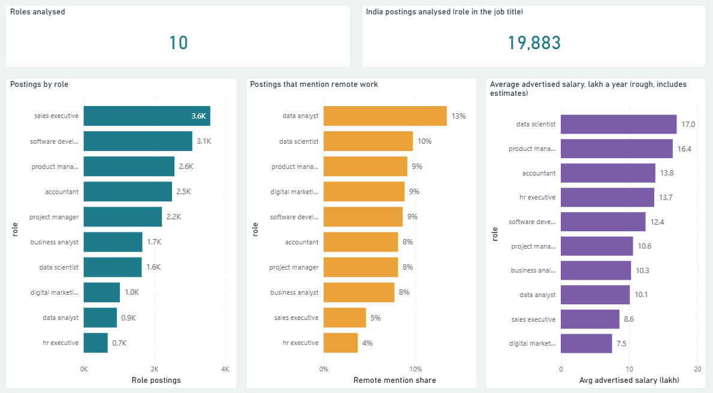
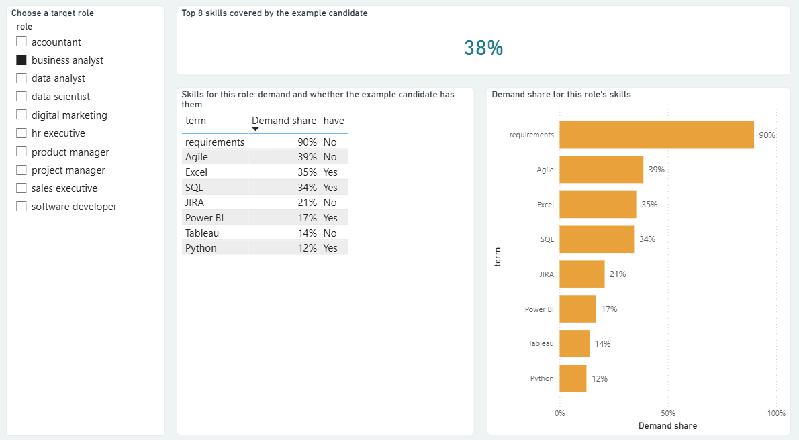
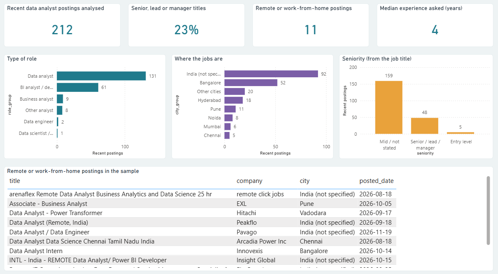

# TalentScope: Job Market and Skill Gap Analysis (India)

**What skills do employers ask for in different jobs, what skills do I already have, and what am I missing for the role I want?**

TalentScope turns raw job postings into career insights. I collected postings for **ten roles in India** from the Adzuna API (24 November 2026), measured which skills each role asks for, and built a skill-gap check that compares a candidate's skills with what a target role asks for. The work is in Python and SQL, with a Power BI dashboard on top.

## The three questions

| Question | How I answered it |
|---|---|
| 1. What skills are companies looking for? | For each of ten roles, I counted how many India postings mention each skill in the full job text |
| 2. What skills does a candidate have? | A simple candidate profile (a CSV of skills with Yes/No) that anyone can edit |
| 3. What is the candidate missing for a role? | A **skill coverage** score and a ranked list of missing skills for every role |

## What I found

| Role | India postings | Top skills mentioned |
|---|---|---|
| Sales executive | 3,582 | communication 66%, negotiation 43%, lead generation 39% |
| Software developer | 3,072 | Java 35%, Python 30%, AWS 28% |
| Product manager | 2,570 | stakeholder 59%, roadmap 59%, analytics 54% |
| Accountant | 2,498 | Excel 54%, GST 30%, Tally 24% |
| Project manager | 2,215 | stakeholder 68%, budget 50%, Agile 30% |
| Business analyst | 1,660 | requirements 90%, Agile 39%, Excel 35% |
| Data scientist | 1,642 | Python 83%, machine learning 78%, statistics 66% |
| Digital marketing | 1,026 | social media 74%, content 71%, SEO 70% |
| Data analyst | 938 | SQL 67%, Python 46%, Excel 45% |
| HR executive | 680 | recruitment 74%, communication 66%, onboarding 52% |

*Postings are those with the role in the job title. Percentages are the share of those postings whose full text mentions the skill. Adzuna's own search does the matching on the full text, so these counts do not depend on the 500-character preview that the API returns.*

- **Each role has its own skill set,** so a skill gap depends on the target role.
- **Excel is the most shared skill.** It is on the list of 8 of the 10 roles, and highest for accountants (54%).
- **SQL is not just for analysts.** It is mentioned in 56% of data scientist postings, 34% of business analyst and 23% of software developer postings.
- **Of the skills I tracked, only 7 show up across three or more roles:** Excel, SQL, Python, Power BI, Agile, JIRA and AWS.
- **Remote and hybrid are mentioned in a minority of postings.** "Remote" appears in 4% to 13% of postings depending on the role (data analyst highest at 13%, and under 10% for the other nine). "Hybrid" appears in 1% to 15%. These are keyword mentions, not a count of fully remote jobs.


## Skill gap check

I tried the check on an example candidate who knows **SQL, Excel, Power BI, Python and statistics**. Coverage is the share of a role's top eight skills (weighted by how often each is mentioned) that the candidate already has.

| Role | Coverage | Biggest gaps |
|---|---|---|
| Data analyst | 78% | Tableau, ETL, machine learning |
| Data scientist | 50% | machine learning, deep learning, AWS |
| Business analyst | 38% | requirements, Agile, JIRA |
| Accountant | 38% | GST, Tally, SAP |
| Software developer | 29% | Java, AWS, JavaScript |
| Product manager | 14% | stakeholder, roadmap, analytics |


Try it with your own skills:

```bash
python analysis/skill_gap.py --role "data scientist" --skills "SQL,Python,Excel"
```

## Power BI dashboard

Five pages: the roles at a glance, the skills for any role, the skill gap across all roles, the skill gap for one role, and a deep dive into data analyst postings.








The skill-gap measure is written in DAX and gives the same numbers as the Python script and the SQL query. Files are in [`powerbi/`](powerbi/).

## How the pipeline works

```
Adzuna API  ->  Extract  ->  Transform and clean (Python)  ->  CSV files  ->  Analyse (Python, SQL)  ->  Power BI
```

1. **Extract:** `data_collection/fetch_role_demand.py` asks the API, for each role and skill, how many postings match. `fetch_adzuna.py` downloads the postings themselves for the data analyst deep dive.
2. **Transform:** `build_dataset.py` removes repeated adverts, keeps analyst titles and recent dates, and works out role group, seniority, remote mentions, experience and salary.
3. **Load:** the cleaned tables are saved in `data/`.
4. **Analyse:** the notebooks and SQL queries answer the three questions, and `analysis/skill_gap.py` runs the gap check from the command line.
5. **Present:** the Power BI dashboard.

## Data analyst deep dive

Adzuna only returns the first 500 characters of each posting, so for the data analyst role I also looked at a cleaned sample of **212 recent postings** (June to November 2026) for the shape of the market:

- 62% are plain "data analyst" roles and 29% are BI analyst or developer roles
- Bangalore leads (52 postings), then Hyderabad (18) and Pune (11)
- 11 postings mention remote or work from home
- The middle salary is about 7.25 lakh a year, but only 28 postings state one, so I would not treat it as the market rate
- The middle experience asked is 4 years, where it is stated (28 postings)

The full write-up is in [`notebooks/data_analyst_deep_dive.ipynb`](notebooks/data_analyst_deep_dive.ipynb).

## Limits of this analysis

- It is **one job site, collected on one day** (the 212-posting sample covers June to November 2026). LinkedIn, Naukri and others may look different, and I could not use them.
- A skill being **mentioned** does not mean it is **required**.
- I count postings with the role **in the title**, so a title like "HR generalist" is not counted under "hr executive".
- I chose a fixed list of skills for each role. A skill that is not on the list cannot show up.
- The salary figures are Adzuna's averages and include estimates, so they are rough. I do not rely on them.
- The skill-gap score is a rough guide. It says nothing about experience, degrees or soft skills.
- **Adzuna does not cover Saudi Arabia or the UAE** (I tested both and the API has no data for them), so this study covers India only.

## What is in this repository

| Path | What it is |
|---|---|
| [`notebooks/job_market_by_role.ipynb`](notebooks/job_market_by_role.ipynb) | The main analysis: roles, skills, remote work, pay and the skill gap |
| [`notebooks/data_analyst_deep_dive.ipynb`](notebooks/data_analyst_deep_dive.ipynb) | A closer look at 212 recent data analyst postings |
| [`sql/job_market_queries.sql`](sql/job_market_queries.sql) | 19 SQL queries (joins, window functions, CTEs, a skill-gap query) with the results I got |
| [`analysis/skill_gap.py`](analysis/skill_gap.py) | Command-line skill-gap tool |
| [`powerbi/`](powerbi/) | The Power BI project |
| [`data/`](data/) | The cleaned datasets and the example candidate profile |
| [`data_collection/`](data_collection/) | The scripts that collect and clean the data |
| [`docs/web-app.md`](docs/web-app.md) | An earlier web app version of TalentScope (FastAPI, React, MongoDB) |

I do not publish the job descriptions themselves, only the counts and the columns I worked out from them.

**To refresh the data**

```bash
pip install -r requirements.txt
# get a free key at https://developer.adzuna.com, then:
export ADZUNA_APP_ID=...  ADZUNA_APP_KEY=...
python data_collection/fetch_role_demand.py
```

Job data from [Adzuna](https://www.adzuna.in).

**Author:** Nida Farheen Khan · [LinkedIn](https://www.linkedin.com/in/nida-khan-237715279)
